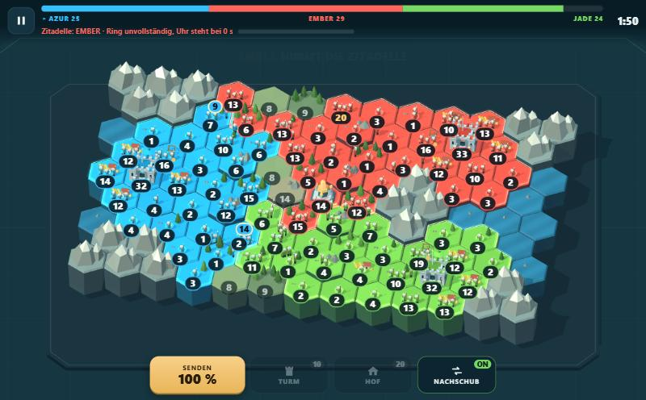

# One Crown · HexWars Diorama

## [▶ Jetzt im Browser spielen](https://emfau88.github.io/Hex-Rework/)

Läuft am PC und am Handy direkt im Browser, ohne Installation. Stand 0.8.2 vom 19.11.2026.

[](https://emfau88.github.io/Hex-Rework/)

Echtzeit-Strategie auf einer plastischen Hex-Insel. Nachfolger von HEXFRONT mit neuen Regeln: Stapeln reicht
nicht mehr, es zählt die Form der Front.

- **Zweig `runden`:** Probe für einen Rundenmodus (Zug um Zug statt Echtzeit). Plan, Regeln und Messwerte:
  [docs/RUNDEN-PLAN.md](docs/RUNDEN-PLAN.md). Die Regeln stehen in `src/sim/turns.js`, die Bedienung im Browser in
  `src/ui/turnplay.js`. Spielen: `node serve.mjs 4181`, im Menü „Rundenmodus · Test“ → „Duell in Runden“. Messen
  mit `node tools/simulate-turns.mjs`.
- **Kampagne „Die Krone ist weg“ (im Bau):** Plan zum Abhaken in
  [docs/UMSETZUNG-RUNDEN.md](docs/UMSETZUNG-RUNDEN.md). Missionen auf Probe stehen nicht im Menü, jede hat ihren
  eigenen Link. Mission 2 „Im Trollwald“:
  [emfau88.github.io/Hex-Rework/runden/?probe=trollwald](https://emfau88.github.io/Hex-Rework/runden/?probe=trollwald),
  lokal `http://localhost:4180/?probe=trollwald`. Messen mit `node tools/audit/mission.mjs trollwald`.
- **Was als Nächstes ansteht:** [docs/ROADMAP.md](docs/ROADMAP.md)
- **Plan, Messwerte und bekannte Schwächen:** [docs/REWORK-PLAN.md](docs/REWORK-PLAN.md)

## Lokal starten

| Wo | Wie |
|---|---|
| PC | `start.bat` doppelklicken. Der Browser öffnet sich von selbst. |
| Handy | `start-handy.bat` doppelklicken. Im Fenster steht eine Adresse wie `http://192.168.x.x:4180/`. Diese im Handy-Browser öffnen (gleiches WLAN). |

Voraussetzung ist Node.js ab Version 20. Es wird nichts installiert und nichts heruntergeladen.
Zum Spielen über den Link oben braucht es das alles nicht.

## Die Regeln in vier Sätzen

1. **Versorgung:** Ein Feld versorgt 20 Truppen, die Burg 40, die Zitadelle 30. Was darüber liegt, schwindet.
   Ein Streifen unter der Zahl jedes eigenen Feldes zeigt, wie voll es ist. Gelb heißt: voll, es wächst nicht mehr.
2. **Kampf an den Kanten:** Ein Kampf dauert. An jeder Feldkante kämpfen höchstens 8 Angreifer, alle
   Verteidiger wehren sich. Von drei Seiten kostet ein Angriff rund ein Drittel.
3. **Burgen fallen durch Umzingeln:** Erst die Felder um die Burg nehmen, dann von allen Seiten stürmen.
4. **Abgeschnitten schwindet:** Felder ohne Verbindung zur eigenen Burg wachsen nicht und verlieren Truppen.

Wer eine Burg erobert, bekommt das ganze Reich. Fällt die eigene Burg, ist die Partie verloren.

## Bedienung

- **Schicken:** von einem eigenen Feld auf ein Ziel ziehen. Oder erst das Feld, dann das Ziel antippen.
- **Vorhersage:** Am Pfeil steht `✓ 7` (das Feld fällt, 7 bleiben übrig) oder `✗ 12` (der Angriff scheitert,
  12 Verteidiger bleiben).
- **Sturm von allen Seiten:** ein fremdes Feld zweimal antippen. Alle eigenen Nachbarfelder greifen zugleich
  an. Nach dem ersten Tipp (am PC schon beim Überfahren mit der Maus) steht die Vorhersage für alle zusammen da.
  Am PC schickt die Taste `S` genau diesen Sturm los, solange seine Vorhersage zu sehen ist.
- **Senden 50 % / 100 %:** Knopf unten links, am PC auch Tasten `1` und `2`.
- **Turm / Hof:** eigenes Feld antippen, dann bauen. Reicht es noch nicht, spart das Feld (dunkles Zeichen an der Zahl,
  sein Ring füllt sich; ist er zu, steht das Gebäude).
  Jedes weitere Gebäude derselben Art kostet mehr. Was ein Feld nicht mehr ersparen kann, gibt es nur sofort:
  Am Knopf steht dann, ab wie vielen Truppen auf dem Feld (zum Beispiel „ab 21 Truppen“). Am PC baut die
  Taste `T` einen Turm, `H` (englisch `F`) einen Hof: auf dem gewählten Feld oder sonst auf dem eigenen Feld
  unter der Maus. Geht es dort nicht, steht am Feld warum.
- **Nachschub:** schickt Truppen aus dem Hinterland an Frontfelder, die noch Platz haben.
- **Abbrechen:** `Esc`, rechte Maustaste oder das gewählte Feld erneut antippen. Das nimmt auch einen
  Sturm zurück, der nach dem ersten Tipp bereitstand.
- **Kampf lesen:** Bei einem Kampf färbt sich der Rand der Feldzahl von oben im Uhrzeigersinn in der Farbe
  der Angreifer. Ist er einmal herum, fällt das Feld. Greifen zwei Reiche an, teilen sie sich den gefärbten
  Teil. Betrifft dich der Kampf, steht über der Zahl, in wie vielen Sekunden das Feld fällt (der Punkt zeigt,
  an wen) oder dass es hält. Neben dem Kampf steht die Zahl der Angreifer. Ist am Handy rundherum kein Platz
  frei, fehlt sie für den Moment, statt eine andere Zahl zu verdecken.
- **Abgelehnte Befehle:** Wird ein Befehl nicht ausgeführt, steht kurz am Feld warum: „Zu wenig Truppen“,
  „Ziel ist voll“ oder „Kein Weg dorthin“.
- **Karte vergrößern und verschieben:** Mausrad oder zwei Finger vergrößern. Ziehen auf fremdem oder leerem
  Gebiet (oder mit zwei Fingern) verschiebt. Der Knopf neben der Uhr und die Taste `0` zeigen wieder alles.
- **Burgmauern:** Eine Burg trägt ein Mauerstück zu jedem Nachbarfeld. Hält ein Gegner das Feld, liegt dort
  nur noch Schutt: So sieht man, von wie vielen Seiten die Burg offen ist.
- **Reiche erkennen:** Jedes Reich trägt einen eigenen Helm (AZUR Kamm, EMBER Hörner, JADE Spitzhelm, SOLAR
  breite Krempe). Im Kampf fällt die letzte Figur um, wenn ihre Truppen fallen.
- **Gebäude lesen:** Am Turm weht eine Fahne in der Farbe des Besitzers. Am Hof wächst das Getreide mit der
  Besatzung von grün zu gold; Rauch steigt auf, solange das Feld versorgt ist.
- **Seitenleisten am PC:** Links das eigene Reich (Felder, Truppen, Zuwachs, Türme, Höfe), rechts die Gegner
  und die letzten Ereignisse. Nur auf breiten Bildschirmen.
- **Pause mit Befehlen:** Knopf oben links, am PC Leertaste oder `P`. Das Spiel steht, die Karte bleibt
  sichtbar, Schicken und Bauen gehen weiter. „Hilfe“ öffnet die Kurzanleitung mit Neustart und Menü.
- **Tempo:** Ruhig (75 %), Normal oder Schnell (130 %), im Menü und unter „Hilfe“. Beim ersten Start gilt
  Ruhig. Das Tempo dehnt nur die Zeit: Regeln, Gegner und Balance bleiben gleich, die Uhr zählt Spielzeit.

## Missionen

| Nr. | Name | Ziel | Neu |
|---|---|---|---|
| 1 | Erste Krone | Burg erobern | Feldgröße, Angriff von mehreren Seiten |
| 2 | Die zwei Pässe | Burg erobern | Türme, Abschneiden eines Vorpostens |
| 3 | Drei Reiche | Zitadelle samt den Feldern ringsum insgesamt 60 Sekunden halten, oder beide Burgen erobern | Zwei Rivalen, Kronenregel |

Jede Mission führt beim ersten Durchspielen in drei bis vier kurzen Schritten durch das, was neu ist. In
Mission 1 hält der Gegner bis zum letzten Schritt still.

Dazu „Gefecht“ auf Zufallskarten: ein Duell und eine Partie mit vier Reichen. Die Inseln sind gespiegelt,
jedes Reich startet auf genau gleichem Land.

## Stärke der Gegner

Entscheidend ist, wie oft ein Reich einen Befehl gibt. Ein Mensch braucht dafür drei bis acht Sekunden. Die
Stufen sind seit Stand 0.7 danach abgestimmt:

- **Leicht:** für den Einstieg. Der Gegner entscheidet etwa alle 14 Sekunden und wächst langsamer.
- **Normal:** für Spieler, die etwa alle 5 Sekunden einen Befehl geben. Der Gegner entscheidet alle 8 Sekunden.
- **Schwer:** für Geübte, die alle 2 bis 3 Sekunden befehlen. Der Gegner entscheidet alle 3 Sekunden.

In der Einführung von Mission 1 wartet der Gegner auf dich: Er nimmt kein Land mehr, sobald er ein Feld mehr
hat als du.

## Figurenschau

Eine kleine Testinsel, um Figuren einzeln anzusehen. Sie steht nicht im Menü, nur hinter einem eigenen Link:
[emfau88.github.io/Hex-Rework/?schau](https://emfau88.github.io/Hex-Rework/?schau) (geht erst nach dem
nächsten Hochladen), lokal `http://localhost:4180/?schau`.

- **Werkzeuge:** „Befehle“ spielt wie sonst. „Troll“ setzt eine Trollhöhle mit so vielen Trollen, wie die Zahl
  daneben sagt. „Wildnis“, die beiden Reiche und „Frei“ setzen das angetippte Feld auf diese Seite, mit so
  vielen Truppen, wie die Zahl sagt. Burgen bleiben, wie sie sind.
- **Zeit:** anhalten, ¼, ½, 1 oder 3-fach, „+1 s“ für genau eine Sekunde. Leertaste hält an und startet.
- **Werte:** Das zuletzt angetippte Feld zeigt bei Ungeheuern Stärke, Angriff, Reichweite, Deckung und
  Vorhaben, bei Reichen Truppen, Zuwachs, Deckung und den laufenden Kampf.
- Der Gegner spielt hier nicht, niemand schickt von selbst Nachschub, abgeschnittene Felder schwinden nicht,
  und die Schau endet nie.

Ungeheuer sind eine eigene Seite, die **Wildnis**, in Violett. Sie gehört keinem Reich, greift jeden an, kann
von jedem angegriffen werden, wächst nicht und schwindet nicht. Sie kann weder gewinnen noch verlieren. Ihre
Figuren tragen ein dunkles Fell mit spitzen Ohren; jede echte Figur bekommt ihr eigenes Modell (Plan in
[docs/INHALTE-PLAN.md](docs/INHALTE-PLAN.md)). In den Missionen gibt es noch keine Ungeheuer.

Die erste echte Figur ist der **Troll**. Seine Höhle hat 30 Trolle und wächst nach. Alle 50 Sekunden ziehen
8 Trolle gegen das schwächste Nachbarfeld eines Reichs. Ein Ring um das Trollgesicht an der Zahl zeigt, wie
nah der Überfall ist. 10 Sekunden vorher ist das Ziel markiert (violetter Ring und Pfeil), und über der Höhle
zählt „Überfall n s“ herunter. Wird die Höhle angegriffen, bleiben alle daheim. Nimmt ein Reich die Höhle, ist sie erledigt. Die Zahlen sind Startwerte (Abschnitt 17 in
[docs/REWORK-PLAN.md](docs/REWORK-PLAN.md)).

## Prüfen ohne Browser

```bash
node --test
```

```bash
node tools/simulate.mjs 60
```

```bash
node tools/showmap.mjs m2
```

```bash
node tools/regions.mjs m3
```

Der erste Befehl lässt alle Tests laufen (Regeln, Bauen, Vorhersage, Eingabe, Ungeheuer). Einer davon spielt
jede Karte vier Minuten und prüft, dass sie Schritt für Schritt genau so läuft wie vor den Ungeheuern. Die Messung zeigt je Karte und
Stärke: Partiedauer, Siege je Startplatz, festgefahrene Partien, wie lange ein untätiger Spieler überlebt, wie
ein starker Testspieler abschneidet und ob der Stapel-Bot gewinnt. Mit `--only=m3`, `--level=hard` und
`--shift=1` (andere Würfel) lässt sie sich eingrenzen.
Alle Stellschrauben stehen in `src/sim/rules.js`, die Karten als Textraster in `src/sim/missions.js`.

## Aufbau

```
src/sim/      Regeln (game), Zahlen (rules), Gegner (ai), Karten (maps, missions): läuft ohne Browser
src/render/   WebGL2-Diorama: Modelle, Licht, Schatten, Belagerer an den Kanten
src/ui/       Zahlen, Pfeile und Vorhersage, Sprachen, Speicherstand
src/audio/    erzeugte Klänge
src/input.js  Ziehen, Tippen, Sturmbefehl
src/main.js   Menü, Besprechung, Spielschleife, Einführung
tests/        Tests für Regeln, Bauen, Vorhersage, Eingabe und Ungeheuer
tools/        Messung, Testspieler, Kartenanzeige, Messung verdeckter Zahlen im Browser
```

Keine Abhängigkeiten, keine Bild-, Modell- oder Tondateien.

## Versionen

Die lokale Versionsverwaltung hält jeden Stand fest. Der Prototyp 0.1 des ersten Entwurfs liegt unter der
Marke `prototyp-0.1`. So wird er als eigener Ordner daneben ausgecheckt, ohne die aktuelle Arbeit zu berühren:

```bash
git worktree add "../HexWars Diorama 0.1" prototyp-0.1
```

## Stand

Stand 0.8.2 vom 19.11.2026: Der Hof ist besser zu sehen (größeres Haus, Äcker auf dunklem Beet), und eine
Baustelle zeigt statt des gelben Punkts ihr Zeichen als Umriss mit einem Ring, der sich mit dem Ersparten
füllt. Nur Darstellung (Abschnitt 18 in [docs/REWORK-PLAN.md](docs/REWORK-PLAN.md)).

Stand 0.8.1 vom 19.11.2026: Felder mit Turm oder Hof tragen links an ihrer Zahl ein rundes Zeichen (Turm,
Haus), wie die Bau-Knöpfe; so erkennt man sie auch am Handy im Überblick. Nur Darstellung, Regeln unverändert
(Abschnitt 18 in [docs/REWORK-PLAN.md](docs/REWORK-PLAN.md)). Geprüft mit 80 Tests.

Nachtrag zu Stand 0.8 (19.11.2026): die Figurenschau unter `?schau` und Ungeheuer als eigene Seite
„Wildnis“, die Grundlage für den Figurenpool (Abschnitt 16 in [docs/REWORK-PLAN.md](docs/REWORK-PLAN.md)),
und als erste Figur der Troll (Abschnitt 17). Im Spiel selbst ändert sich dadurch nichts.

Stand 0.8 vom 19.11.2026: Tasten am PC für Sturm und Bauen, ein Streifen für den Füllstand eigener Felder, am
Handy verdeckt keine Zahl mehr eine andere, Menü und Hilfe passen am PC ohne Scrollen auf 720 Punkte Höhe
(Abschnitt 15 in [docs/REWORK-PLAN.md](docs/REWORK-PLAN.md)). Davor Stand 0.7 und 0.7.1: Die Gegner sind für
Menschen neu abgestimmt (Abschnitt 14); bis Stand 0.6 war selbst Mission 1 nur mit einem Befehl alle 1,5
Sekunden sicher zu gewinnen. Davor Stand 0.6: Helmformen je Reich, umfallende Figuren, weiche Schatten, Gebäude mit Zustand,
Seitenleisten am PC (Abschnitt 13 in [docs/REWORK-PLAN.md](docs/REWORK-PLAN.md)). Davor Stand 0.5: abgelehnte
Befehle werden rückgemeldet, Zoom und Verschieben, Meer rund um die Insel, Burgmauern (Abschnitt 12), Stand 0.4: Tempo-Schalter,
Pause mit Befehlen, Kampfanzeige, Kampfanimation, Gebirge und Böschungen (Abschnitt 11), und Stand 0.3.1: drei
Fehler aus einer Fremdprüfung behoben (Abschnitt 10). Geprüft mit 79 Tests, Messläufen und Durchläufen im
Browser am PC und im Handy-Format. Nicht geprüft: ein Mensch am Spiel, echtes Handy, Ton, Safari.
